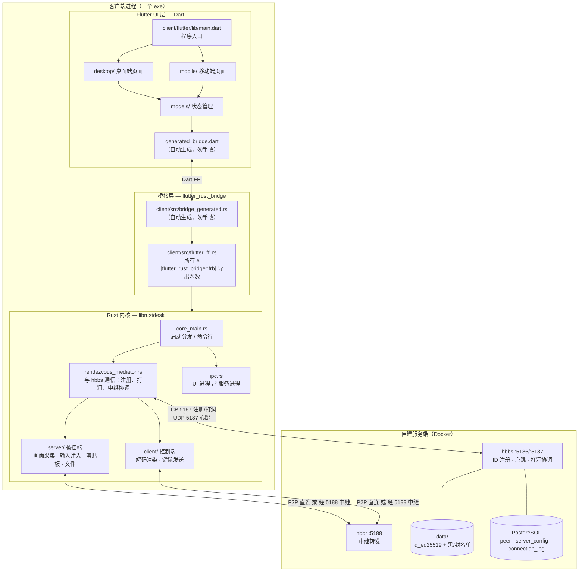
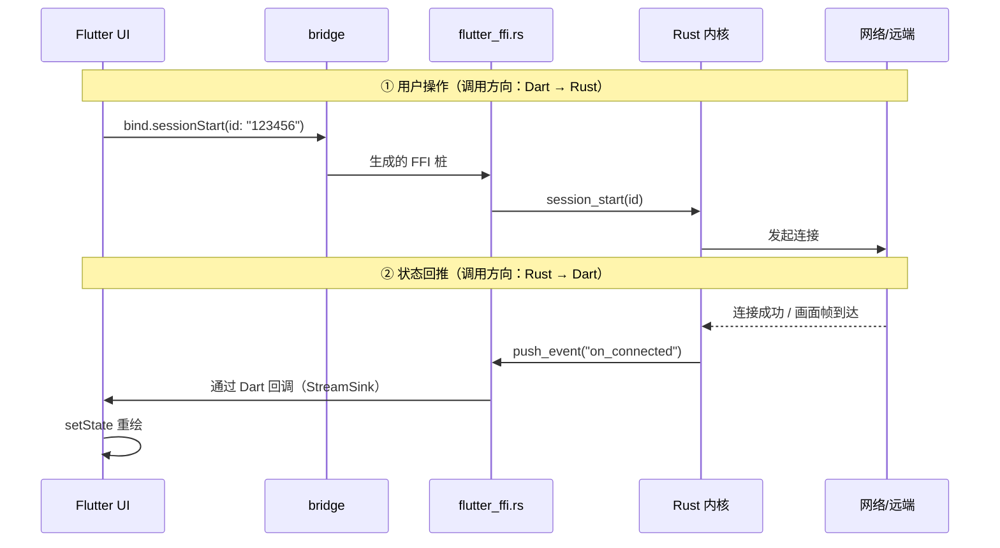
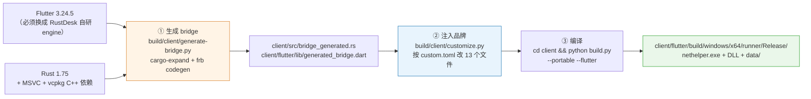
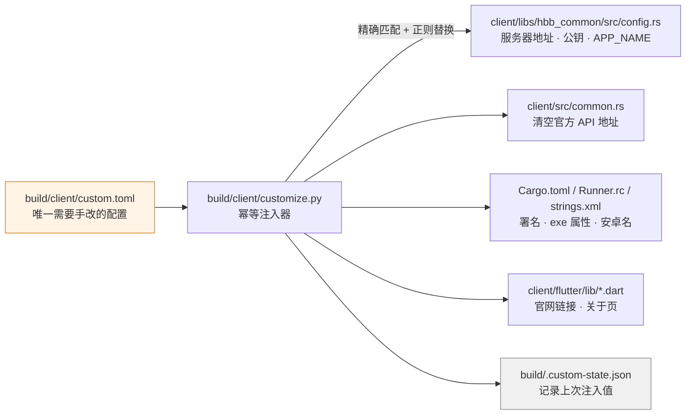

# 01 · 架构总览

> 目标：读完之后，你能回答「一个功能大概长在哪个文件里」「我改一行代码会影响哪几层」「构建出来的 exe 是怎么拼出来的」。

---

## 一、一句话概括

wedesk = **RustDesk v1.5.1 的源码** + **我们自己的品牌/服务器注入层** + **自建服务端部署编排**。

客户端是一个 **Rust 内核 + Flutter 外壳** 的双层程序：

- **Rust 内核**（`client/src/`、`client/libs/`）：干所有重活 —— 屏幕采集、编解码、网络、加密、输入注入、IPC。
- **Flutter UI**（`client/flutter/`）：只负责画界面。它通过一层**自动生成的代码桥**（bridge）调用 Rust，自己不实现任何远程桌面逻辑。

这两层之间**没有手写胶水代码**，全靠构建期代码生成。这是理解整个项目最关键的一点，也是最容易卡住构建的地方（见 [03-build.md](03-build.md)）。

---

## 二、整体架构图



**要点**：

- 控制端和被控端**在同一个二进制里**。同一个 exe，发起连接时它是 client，被连接时它是 server。所以 `client/src/client/` 和 `client/src/server/` 是两套并列逻辑，不是一个 C/S 程序的两端。
- **服务端（hbbs/hbbr）源码就在本仓库** `server/src/`，镜像是本地编译出来的，
  与官方镜像无关。升级/自编译见 [09 服务端自编译](09-server-build.md)。
- Flutter 侧**不存在任何网络代码**。要找"连接是怎么建立的"，去 `client/src/rendezvous_mediator.rs`。

---

## 三、三层架构的分工

| 层 | 目录 | 语言 | 职责 | 你不能在这里做什么 |
|---|---|---|---|---|
| UI | `client/flutter/lib/` | Dart | 窗口、页面、状态、交互 | 不能直接碰网络、不能读写摄像头/屏幕 |
| 桥 | `client/src/flutter_ffi.rs` | Rust | 把 Rust 函数导出给 Dart 调 | 不写业务逻辑，只做转发 |
| 内核 | `client/src/`、`client/libs/` | Rust | 全部业务逻辑 | 不直接画 UI，通过 `flutter_ffi.rs` 回推事件 |

### 数据流是双向的

很多人以为 Dart 单向调用 Rust 就够了，实际上事件是**反向推送**的：



**新增功能时最容易踩的坑**：只写了 ① 忘了 ②，结果 Rust 那边事情干完了，界面没反应。详见 [06-maintenance.md](06-maintenance.md)。

---

## 四、目录职责速查

### `client/`（客户端源码根 = crate 根）

上游源码**整棵树收在 `client/` 下**，`Cargo.toml`、`build.py` 都在 `client/` 最外层，
内部**没有 `rustdesk/` 子目录**（当初就是为了免掉一层目录换算）。所有相对路径
以 `client/` 为根 —— 包括 `build.py`，它必须在 `client/` 里执行。

| 路径 | 是什么 | 升级上游时要不要覆盖 |
|---|---|---|
| `client/src/` | Rust 内核源码 | ✅ 覆盖 |
| `client/libs/` | Rust 内核依赖库（含 `hbb_common`） | ✅ 覆盖 |
| `client/flutter/` | Flutter UI 全部代码 | ✅ 覆盖 |
| `client/res/` | 图标、安装包素材、构建辅助脚本 | ✅ 覆盖 |
| `client/Cargo.toml` / `client/Cargo.lock` / `client/build.py` / `client/build.rs` | 构建定义 | ✅ 覆盖 |
| `client/vcpkg.json` / `client/Dockerfile` / `client/entrypoint.sh` / `client/LICENCE` | 依赖清单 / Linux 构建镜像 | ✅ 覆盖 |
| `.github/patches/` | Flutter engine 补丁 | ⚠️ 只覆盖这一个子目录 |
| `docs/upstream/` | 上游自带的多语言文档 | ✅ 覆盖 |
| **`build/`** | **我们的脚本与配置（customize.py 等）** | ❌ **永不覆盖** |
| **`server/`** | **服务端源码 + Docker 编排 + rdctl.py** | ❌ **永不覆盖** |
| **`upstream/`** | **上游基线记录 + 定制补丁** | ❌ **永不覆盖** |
| **`docs/`** | **我们的文档** | ❌ **永不覆盖** |
| `README.md` / `.gitignore` / `.gitattributes` | 自有文件 | ❌ **永不覆盖** |

> `client/libs/hbb_common` 上游是 submodule，整合时已**实体化为普通目录**。
> 服务器地址、公钥、APP_NAME 都定义在里面。若哪天被误恢复成 submodule，所有定制会**静默失效**。

### Rust 内核关键文件

| 文件 | 干什么 | 什么时候会动它 |
|---|---|---|
| `client/src/main.rs` | 进程入口，分发到 UI 或 CLI | 几乎不动 |
| `client/src/core_main.rs` | 启动逻辑、命令行参数、`--connect` 等 | 加命令行功能时 |
| `client/src/rendezvous_mediator.rs` | **连接的核心**：注册 ID、心跳、打洞、中继协调 | 改连接行为、加审计埋点 |
| `client/src/flutter_ffi.rs` | **Dart ⇄ Rust 的所有导出函数** | **新增 UI 功能必改** |
| `client/src/server/connection.rs` | 被控端单条连接的处理循环 | 改会话逻辑、权限校验 |
| `client/src/server/video_service.rs` | 屏幕采集 | 改采集策略/帧率 |
| `client/src/server/input_service.rs` | 键鼠注入 | 加输入限制 |
| `client/src/client/io_loop.rs` | 控制端收包循环 | 改解码/渲染 |
| `client/src/ipc.rs` | UI 进程与服务进程通信（Windows 服务场景） | 服务化部署相关 |
| `client/src/common.rs` | 全局工具、API 地址、更新检查 | **已改过：封死官方更新通道** |
| `client/src/updater.rs` | 自动更新 | 改更新策略 |
| `client/libs/hbb_common/src/config.rs` | **配置中枢**：服务器地址、公钥、APP_NAME、端口 | **已改过：注入品牌三值** |

### Flutter 侧关键文件

| 文件 | 干什么 |
|---|---|
| `client/flutter/lib/main.dart` | Dart 入口 |
| `client/flutter/lib/common.dart` | 全局工具、常量、`appName` getter |
| `client/flutter/lib/consts.dart` | UI 常量（颜色、尺寸、能力开关） |
| `client/flutter/lib/models/` | 状态管理（每个 `*_model.dart` 管一块状态） |
| `client/flutter/lib/desktop/pages/` | 桌面端页面 |
| `client/flutter/lib/desktop/widgets/` | 桌面端可复用组件 |
| `client/flutter/lib/generated_bridge.dart` | **自动生成，不要手改**（构建会覆盖） |

---

## 五、构建产物是怎么拼出来的

这是理解构建流程的图，也是排查"为什么构建失败"的地图：



**三个阶段的失败模式完全不同**：

| 阶段 | 典型失败 | 排查入口 |
|---|---|---|
| ① 生成 bridge | `file not found for module bridge_generated` | 说明 `client/src/bridge_generated.rs` 没生成出来 |
| ② 注入品牌 | 编译通过但连的是官方服务器 | `customize.py --dry-run` 看命中数 |
| ③ 编译 | vcpkg 缺库、engine 没换、LLVM 版本不对 | 见 [07-faq.md](07-faq.md) |

---

## 六、定制是怎么注入的

我们不 fork 上游改代码，而是**在构建前用脚本改源码的兜底常量**。这样上游升级时只需重跑脚本，不用解冲突。



为什么要 `.custom-state.json`：脚本需要知道"上次注入的是什么"，否则你把公司名从 A 改成 B 时，脚本还在找 A，就会**静默不命中**。

**改的是「兜底默认值」而不是硬锁定**，优先级链如下（前面的赢）：

```
命令行参数  >  界面里用户填的  >  编译期注入  >  本地配置文件  >  兜底常量 ← 我们改这层
```

好处：员工仍可在设置里临时改服务器调试，但出厂默认值永远指向我们自己的服务器。

详见 [05-customize.md](05-customize.md)。

---

## 七、接下来的阅读顺序

| 你想做什么 | 读哪篇 |
|---|---|
| 搞懂连接是怎么建立的 | [02-runtime.md](02-runtime.md) |
| 在本机编译出 exe | [03-build.md](03-build.md) |
| 用 GitHub Actions 云编译 | [03b-ci.md](03b-ci.md) |
| 部署服务端、分发客户端 | [04-deploy.md](04-deploy.md) |
| 换 Logo、改品牌、隐藏功能 | [05-customize.md](05-customize.md) |
| 加一个新功能 | [06-maintenance.md](06-maintenance.md) |
| 构建挂了 / 连不上 | [07-faq.md](07-faq.md) |
