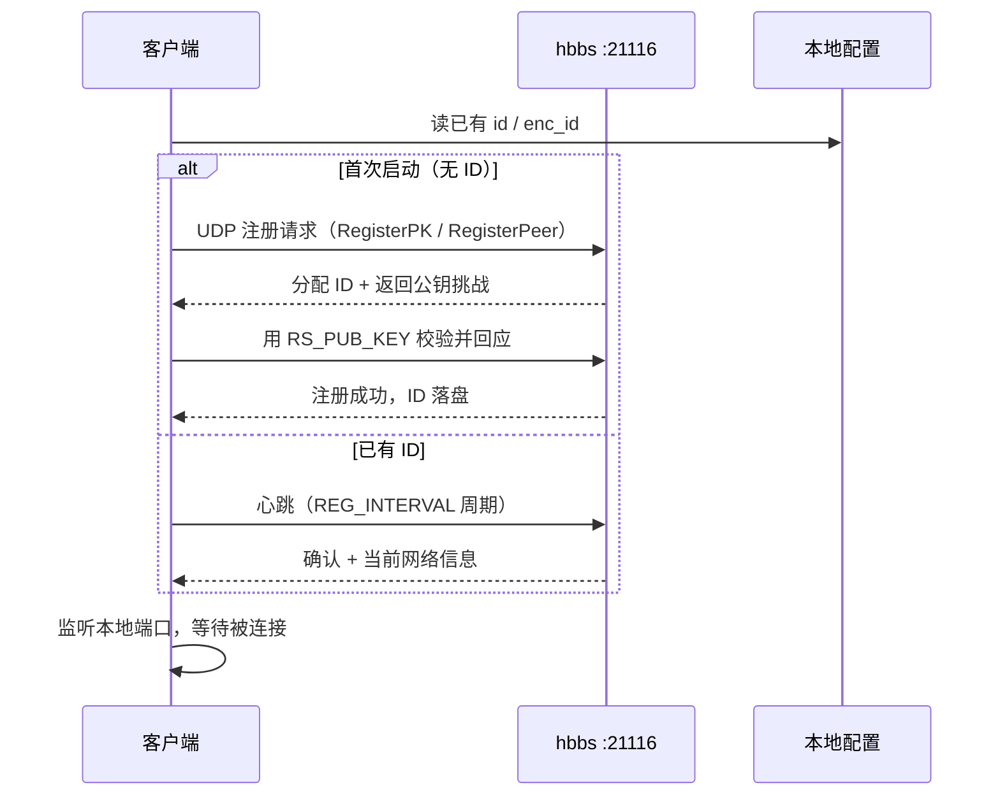
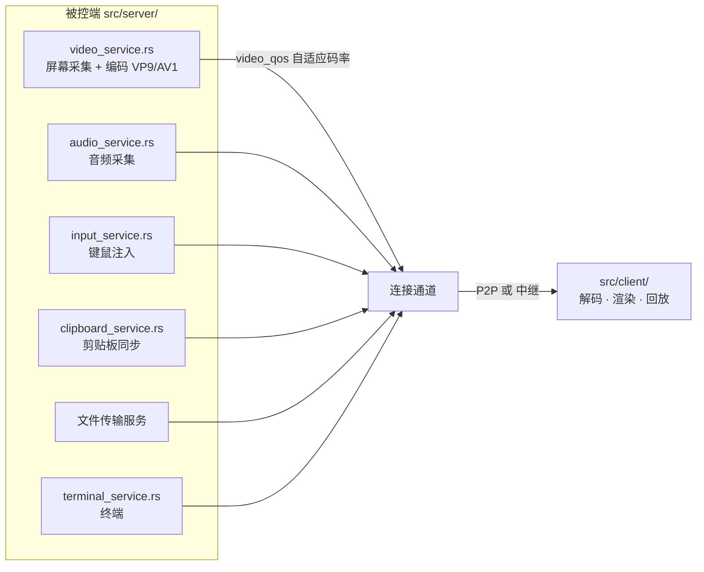
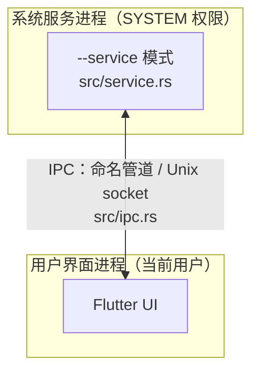

# 02 · 运行原理

> 目标：搞懂「输入一个 ID 按下连接，到看到对方桌面」中间到底发生了什么。
> 排障时这份文档能帮你判断「问题出在哪一跳」。

---

## 一、三个角色

| 角色 | 谁 | 干什么 |
|---|---|---|
| **hbbs**（ID/注册服务器） | 我们部署的服务端 | 登记"ID → 当前 IP:端口"的映射，协调打洞。**不转发画面数据** |
| **hbbr**（中继服务器） | 我们部署的服务端 | 打洞失败时转发画面数据。**消耗服务器带宽** |
| **客户端** | 员工机器上的 exe | 既可以是控制端也可以是被控端（同一个二进制） |

**关键认知**：hbbs **只做撮合**，真正的数据流要么 P2P 直连，要么走 hbbr 中转。
所以服务器带宽压力取决于打洞成功率，而不是在线人数。

---

## 二、启动阶段：ID 是怎么来的



**ID 与公钥的关系**：

- ID 由 hbbs 分配，写在客户端本地配置里
- `RS_PUB_KEY`（我们的：`bMwHjGjrhpNvD+lyhx2daVmrhmq94hyDfHNisznZTl0=`）是 **hbbs 的 ed25519 公钥**
- 客户端用它验证"我连的确实是自家服务器"，**防止中间人把连接引到别人的服务器**
- 公钥与 `server/data/id_ed25519` 是配对关系。**密钥丢了 = 所有客户端要重新配置**，务必备份

> 改 `RS_PUB_KEY` 后，老客户端会拒绝连接（公钥不匹配）。这是安全特性，不是 bug。

---

## 三、建立连接：完整时序

这是最该看懂的一张图。

```mermaid
sequenceDiagram
    autonumber
    participant C as 控制端（发起方）
    participant HBBS as hbbs :21116
    participant HBBR as hbbr :21117
    participant S as 被控端（接受方）

    C->>HBBS: ① 请求连接目标 ID
    HBBS->>S: ② 转发：有人要连你，请打洞
    HBBS-->>C: ③ 返回被控端的外网地址

    par 并行打洞
        C->>S: ④a 向对方地址发 UDP/TCP 包（打洞）
        S->>C: ④b 同时向对方地址发包
    end

    alt 打洞成功 —— P2P 直连
        C<<->>S: ⑤ 直连建立，数据不经过服务器
        Note over C,S: ✅ 服务器零带宽消耗
    else 打洞失败 —— 走中继
        C->>HBBR: ⑤' 连接中继
        S->>HBBR: ⑤' 连接中继
        HBBR-->>C: ⑥ 中继转发画面/输入
        Note over C,HBBR,S: ⚠️ 所有流量过服务器，按带宽计费
    end

    C->>S: ⑦ 认证（密码 / 一次性码 / 免密）
    S-->>C: ⑧ 认证通过，推送权限
    C->>S: ⑨ 订阅视频流、发送键鼠事件
```

### 打洞为什么可行（简化版）

NAT 设备会记住"内网某台机器访问过哪个外部地址"，并为之开一个临时映射。
打洞就是**让双方同时向对方发包**：

1. 控制端发一个包到被控端的**外网地址** → 控制端的 NAT 开了洞，但这个包会被被控端 NAT 丢弃
2. 被控端同时也发一个包到控制端的**外网地址** → 此时控制端的 NAT 已经"见过"这个地址，包被放行
3. 双向通路建立

hbbs 的作用是**告诉双方对方的外网地址是什么**，它不参与数据传输。

**打洞成功率**取决于 NAT 类型：

| 场景 | 能否打洞 | 说明 |
|---|---|---|
| 双方同一局域网 | ✅ 直接走内网 | 最快，不经过任何服务器 |
| 家庭宽带（锥形 NAT） | ✅ 通常成功 | 最常见场景 |
| 对称 NAT（企业/4G/校园网） | ❌ 常失败 | 只能走中继 |
| 一方有公网 IP | ✅ 基本成功 | |

**内网团队场景建议**：`ALWAYS_USE_RELAY=N`（默认），让同网段的机器走 P2P，省服务器带宽。

---

## 四、会话内的数据流

连接建立后，被控端会为**每一种数据类型开一条独立的逻辑流**：



| 流 | 被控端实现 | 控制端实现 | 降级/限制点 |
|---|---|---|---|
| 视频 | `video_service.rs` | `client/io_loop.rs` | `video_qos/` 会按网络质量降码率 |
| 音频 | `audio_service.rs` | `client/audio_playback.rs` | 有断流恢复逻辑 |
| 输入 | `input_service.rs` | 键鼠事件上行 | 权限控制（是否允许控制） |
| 剪贴板 | `clipboard_service.rs` | 双向同步 | 可单独禁用 |
| 文件 | 文件传输服务 | `client/file_trait.rs` | **防泄密重点关注** |
| 终端 | `terminal_service.rs` | — | Linux/macOS 为主 |

> **想禁用某条流做合规（比如禁文件传输）**，最彻底的做法是**两端同时改**：
> Rust 侧不提供服务 + Flutter 侧隐藏入口。只隐藏 UI 是假禁用。

---

## 五、服务模式与 IPC

Windows 上有两种运行形态：



**为什么需要服务进程**：

- 无人值守访问（开机就能被连，不需要用户先登录）
- 登录屏/UAC 界面也能操作（用户进程权限不够）
- 切换用户不掉线

**IPC 通信内容**：连接请求、权限确认弹窗、配置同步、状态上报。
`is_service_ipc_postfix()`（`libs/hbb_common/src/config.rs`）保护 `_service` 这个跨用户 IPC 通道名。

> 单人单机使用可以不装服务，双击 exe 就行。
> **要做"网管随时能接管"就必须装服务**（`--silent-install` / 服务安装）。

---

## 六、更新检查（我们改过的地方）

上游行为：客户端会周期性请求 `https://api.rustdesk.com/version/latest`。
这对私有化部署是**不可接受的外网请求**。

我们加了两道闸：

| 位置 | 函数 | 状态 |
|---|---|---|
| `src/common.rs` | `check_software_update()`（自动检查） | 上游本来就有 `is_custom_client()` 早退 |
| `src/common.rs` | `do_check_software_update()`（手动点"检查更新"） | ⭐ **我们补的** —— 上游漏了这道 |

**为什么必须补第二道**：用户在"关于"页手动点检查更新时，`src/updater.rs` 会**绕过第一道闸**直接调 `do_check_software_update()`。
上游只在自动检查处设了卡点，手动路径是敞开的。

**为什么返回 `Ok` 而不是 `Err`**：`updater.rs` 读到空的更新 URL 时会走 `"No update available."` 分支，
UI 显示"已是最新版本"，不会弹任何报错。断网这个动作对用户是**无感的**。

```rust
// src/common.rs — do_check_software_update() 开头
if is_custom_client() {
    return Ok(());
}
```

> ⚠️ 这是**手工源码改动**，不在 `customize.py` 的规则表里（带逻辑判断，塞不进字符串替换）。
> 升级上游时必须手动重做，见 [06-maintenance.md](06-maintenance.md)。

---

## 七、配置文件在哪

| 平台 | 路径 |
|---|---|
| Windows（便携版） | exe 同目录下的 `config/` |
| Windows（安装版） | `%APPDATA%\<AppName>\config\` |
| Linux | `~/.config/<appname>/` |
| macOS | `~/Library/Preferences/<appname>/` |

关键文件：

- `RustDesk.toml`（或按 APP_NAME 命名）—— 主配置
- `RustDesk2.toml` —— 界面选项（语言、主题等）
- `id_ed25519` / `id_ed25519.pub` —— **服务端的**，在 `server/data/`，与客户端无关

**改配置不生效时**：UI 进程和服务进程各持有一份内存配置，改完需要**重启服务**才同步。

---

## 八、一句话排障定位

| 现象 | 大概率在哪一跳 |
|---|---|
| 客户端显示"未就绪"/ID 出不来 | hbbs 连不上（端口/防火墙/地址写错） |
| ID 有，但连不上对方 | 打洞失败 且 hbbr 未通 |
| 能连但极卡 | 走了中继（`ALWAYS_USE_RELAY=Y` 或对称 NAT） |
| 提示公钥不匹配 | `RS_PUB_KEY` 与服务端 `id_ed25519.pub` 不配对 |
| 连上就断 | 认证超时 / 服务进程未运行 |

详细排查步骤见 [07-faq.md](07-faq.md)。
