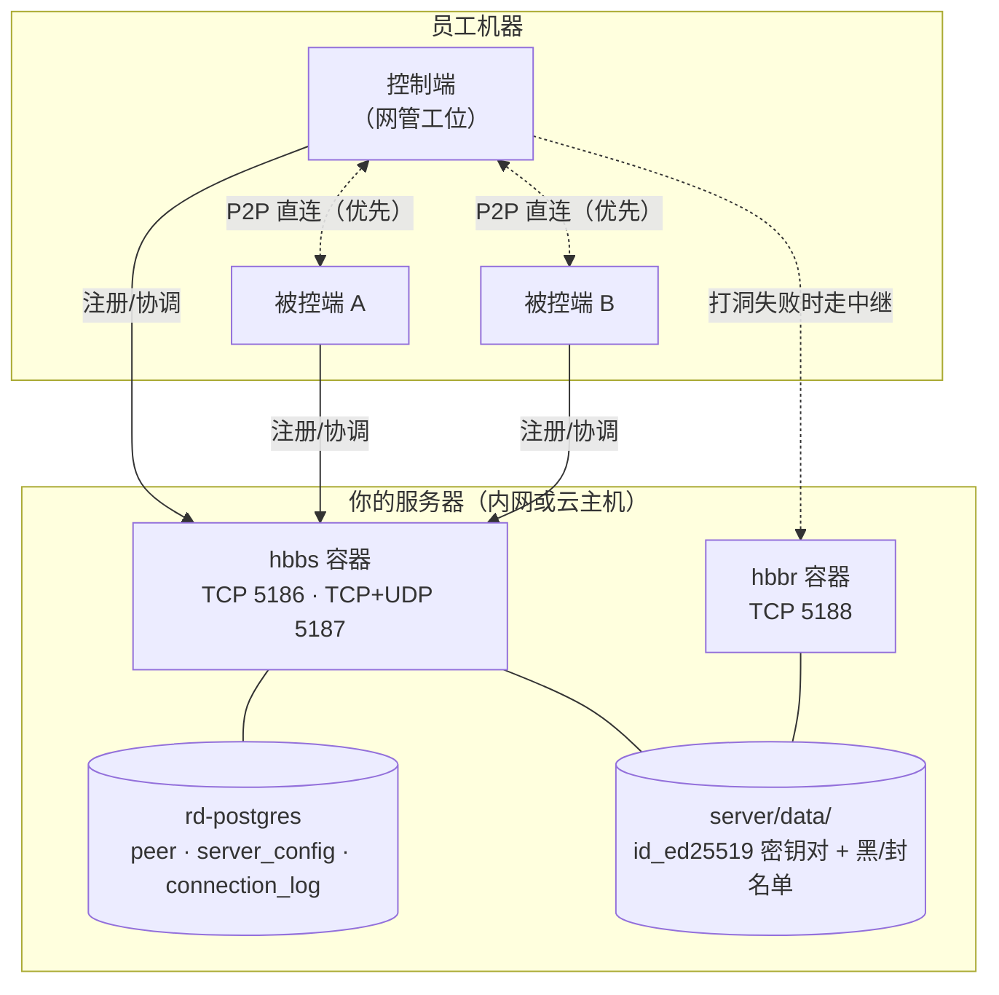

# 04 · 部署指南

> 文档索引：[`docs/README.md`](README.md) ｜ 上一篇：[03b CI 云构建](03b-ci.md) ｜ 下一篇：[05 定制指南](05-customize.md)

> 目标：从零把整套系统跑起来 —— 服务端上线、客户端分发给员工。

---

## 一、部署拓扑



**带宽估算**：hbbs 只传控制信令（每人几 KB/分钟）；**hbbr 传全部画面流量**（每人 100 KB/s ~ 2 MB/s 视画质）。
若团队都在同一内网，P2P 成功率极高，hbbr 几乎不耗带宽。

---

## 二、服务端部署

### 2.1 前置条件

- Docker + Docker Compose
- 一台能被所有客户端访问到的主机（内网服务器或云主机）
- 放行端口：**TCP 5186、TCP 5187、UDP 5187、TCP 5188**

### 2.2 三步启动

```bash
cd server\deploy
copy .env.example .env      # 复制配置模板
# 编辑 .env，把 RELAY_HOST 改成服务器的实际 IP 或域名
python rdctl.py start       # 没有本地镜像时会先自动从源码构建（首次约 15-25 分钟）
python rdctl.py key         # 打印公钥 —— 记下来，客户端要用
```

`rdctl.py key` 输出的这串 Base64 就是 `RS_PUB_KEY`，需要填进 `build/client/custom.toml`。

> **容器里的二进制是自己编译出来的**，不是 `rustdesk/rustdesk-server` 官方镜像。
> 源码就在 `server/src/`，编译过程见 [09 服务端自编译](09-server-build.md)。
> 想手工重新构建：`python rdctl.py build`（等价于 `docker compose build`）。

### 2.3 常用命令

| 命令 | 作用 |
|---|---|
| `python rdctl.py build` | 从本仓库源码构建服务端镜像（改过服务端源码后必须跑） |
| `python rdctl.py start` | 启动（首次自动生成密钥对；本地无镜像会先构建） |
| `python rdctl.py stop` | 停止 |
| `python rdctl.py restart` | 重启 |
| `python rdctl.py status` | 查看运行状态与容器健康 |
| `python rdctl.py logs` | 跟踪日志 |
| `python rdctl.py key` | 显示公钥 |
| `python rdctl.py backup` | **备份密钥与数据库** |
| `python rdctl.py uninstall` | 卸载（会二次确认） |

### 2.4 `.env` 关键参数

| 变量 | 默认 | 说明 |
|---|---|---|
| `RELAY_HOST` | `127.0.0.1` | **必须改成实际 IP/域名**，客户端靠它找中继 |
| `ALWAYS_USE_RELAY` | `N` | `N`=优先 P2P（内网推荐）；`Y`=强制走中继（跨公网、提高连通率，耗带宽） |
| `RD_IMAGE` | `wedesk-server:latest` | 本地源码构建的镜像。想用 CI 推的远端镜像改这里：<br>`RD_IMAGE=liaozhiming/wedesk-server:latest`；<br>改回 `rustdesk/rustdesk-server:latest` 则用官方镜像（**会失去本地化补丁**） |
| `RUST_LOG` | `info` | 排障时调 `debug` |
| `HBBS_PORT` / `HBBS_NAT_PORT` / `HBBR_PORT` | 5187/5186/5188 | 整体平移时才改。<br>必须满足 `HBBS_NAT_PORT = HBBS_PORT - 1`，`rdctl.py start` 会校验 |

### 2.5 端口清单

> 本节只给结论。**端口是从主端口推导出来的**（hbbs 用 P-1/P/P+2，hbbr 用 R/R+2），
> 要改端口、上公网、或用 host 网络之前，请务必先读 [10 端口与网络规划](10-ports.md)。

| 端口 | 协议 | 用途 | 必须开放 |
|---|---|---|---|
| 5186 | TCP | NAT 类型探测 | ✅ |
| 5187 | TCP | TCP 打洞与连接服务 | ✅ |
| 5187 | UDP | ID 注册 + 心跳 | ✅ |
| 5188 | TCP | 中继 | ✅ |
| 5189 | TCP | hbbs WebSocket 注册通道（UDP 不通时客户端走这里） | ✅ |
| 5190 | TCP | hbbr WebSocket 中继 | ✅ |
| 5191 / 5192 | TCP | 健康检查 GET /health | 建议 |

> **5189/5190 现在是开的**（2026-10-20 修正）：客户端 UDP 不通或勾了"使用 WebSocket"
> 时要用 5189 注册，摸不到就永远卡在"正在接入网络"。
>
> 保留一点警惕：WebSocket 分支会**无条件信任**请求里的 `X-Real-IP` /
> `X-Forwarded-For` 头而不做校验。这只在**前面挂了反向代理**时才构成风险 ——
> 让代理统一覆写该头并限制仅代理 IP 可访问；做不到就注释掉 compose 里那两条映射。

### 2.6 生产环境建议

```yaml
# docker-compose.yml 里把两处 networks/ports 替换为：
network_mode: "host"
```

`--net=host` 能拿到**真实来源 IP**（端口映射模式下所有来源都显示成网关 IP），
对审计很重要。**仅 Linux 生效**，Windows/macOS 保持端口映射写法。

切到 host 网络后，在云平台安全组放行 TCP 5186/5187/5188 + UDP 5187。

> ⚠️ **切 host 之前先在防火墙 DROP 5189 / 5190**。
> 端口映射带来的隔离会一并消失，容器里那两个未被 publish 的 WebSocket 端口
> 会原样暴露到宿主网络栈。具体原因与命令见 [10 端口与网络规划 → 第 4 节](10-ports.md#4-三个必须先知道的坑)。

---

## 三、密钥管理（最重要的一节）

```
server/data/
├── id_ed25519        # 私钥 —— 丢了所有客户端要重配
├── id_ed25519.pub    # 公钥
├── db_v2.sqlite3     # peer 注册表（仅 SQLite 后端时存在）
├── blacklist.txt     # hbbr 黑名单（可选，每行一个 IP，命中后限速）
└── blocklist.txt     # hbbr 阻断名单（可选，命中即断开）
```

> **默认后端是 PostgreSQL**：名单会落进 `relay_access_list` 表，
> 上面这两个文件只在**没给 hbbr 配数据库**时才用（hbbr 会自动把老文件内容
> 迁移进库一次）。维护方式见 [11 运维手册](11-server-ops.md) 的 6.2 节。
> `db_v2.sqlite3` 只在显式设了 `DB_TYPE=sqlite` 时才出现。
> 连接审计记在 PG 的 `connection_log` 表里（SQLite 后端下不记录）。
> 详见 [12 · 服务端数据统一存 PostgreSQL](12-postgres-backend.md)。

**这三条务必记住**：

1. **密钥只生成一次。** 只要 `server/data/id_ed25519` 存在，重启不会重新生成。
   一旦重新生成，所有已分发客户端的 `RS_PUB_KEY` 全部失效，必须重新分发。
2. **定期备份。** `python rdctl.py backup` 会打包密钥 + 数据库。
   建议加进 crontab / 计划任务，异地存一份。
3. **`.env` 与 `server/data/` 已在 `.gitignore` 里**，不会进仓库 —— 这是有意为之，别改。

> 如果密钥丢了又没备份：只能重新生成 → 重新注入 `RS_PUB_KEY` → **重新构建并分发所有客户端**。
> 所以备份这一条不是建议，是必需。

---

## 四、客户端分发

构建产物在 `client/flutter/build/windows/x64/runner/Release/`：

```
Release/
├── wedesk.exe           # 主程序（名字由 custom.toml 的 exe_name 决定）
├── *.dll                   # Rust 与 C++ 依赖
└── data/                   # Flutter 资源
```

### 三种分发形态

| 形态 | 做法 | 适用场景 |
|---|---|---|
| **便携版** | 整个 `Release/` 目录打包成 zip | 快速试用、U 盘携带。双击即用，不写注册表 |
| **安装版** | 用 Inno Setup / MSI 打包 | 正式分发，带开始菜单与卸载入口 |
| **静默装服务** | 安装时带参数装系统服务 | **网管需要无人值守接管** |

### 无人值守（推荐网管场景）

要让"员工不在电脑前 / 没登录时也能被连"，必须装系统服务：

```bat
wedesk.exe --silent-install        :: 静默安装服务
```

装上之后客户端会随系统启动，登录屏和 UAC 界面也能操作。

### 分发前必查清单

```
□ custom.toml 的 rendezvous_host 填的是服务器实际 IP
□ RS_PUB_KEY 与服务端 rdctl.py key 输出一致
□ 试连两台机器，确认直连成功（不是走中继）
□ 确认没有连到官方服务器：断开公网后仍能连接
□ 图标与 APP_NAME 已替换（还是 RustDesk 原样说明 customize.py 没跑成功）
```

---

## 五、客户端升级

定制客户端**不走官方更新通道**（已封死，见 [02-runtime.md](02-runtime.md)）。
所以更新只能靠人工分发：

1. 改代码 → 重新构建 → 出新版本 zip
2. 通过企业微信/共享盘/组策略推给员工
3. 员工覆盖解压即可（配置与 ID **会保留**，因为它们在 `config/` 目录）

> 配置目录与程序目录是分开的，覆盖 exe **不会丢 ID**。
> 但如果员工用的是便携版且配置在 exe 同目录，覆盖时要**保留 `config/` 目录**。

---

## 六、合规提醒

RustDesk 是 **AGPL-3.0**，衍生作品必须沿用同一许可证：

| 场景 | 是否触发开源义务 |
|---|---|
| 公司内部使用 | ❌ 不触发（未"分发"给外部） |
| 仓库设为公开 | ✅ 天然满足（源码可见） |
| **只把 exe 发给外部客户、不给源码** | ⚠️ **违反 AGPL §13** |
| 团队内部私有仓库 | ❌ 不触发 |

`client/LICENCE` 就是 AGPL-3.0（英式拼写，GitHub 能正常识别）。
**不要删它，也不要改成 Apache/MIT。**

---

## 七、上线检查表

```
服务端
□ Docker 与 Compose 可用
□ .env 的 RELAY_HOST 已改成实际 IP
□ 端口已放行（TCP 5186/5187/5188 + UDP 5187）
□ rdctl.py status 显示健康
□ 公网 key 已备份到异地

客户端
□ customize.py 注入成功（8/8 命中）
□ 构建产物能启动、ID 正常生成
□ 两台机器互连成功
□ 断公网后仍能连接（证明没连官方）
□ 装了服务（如需无人值守）

运维
□ backup 已进计划任务
□ 知道密钥丢失的恢复代价
□ 有客户端分发渠道
```
