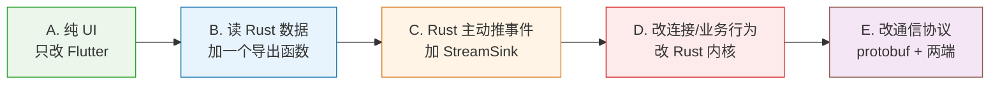

# 06 · 维护手册

> 文档索引：[`docs/README.md`](README.md) ｜ 上一篇：[05 定制指南](05-customize.md) ｜ 下一篇：[07 故障排查](07-faq.md)

> 目标：加新功能、升上游、改 bug 时知道该动哪些文件、按什么顺序做、做完要补什么。

---

## 一、三种维护场景

| 场景 | 频率 | 主要风险 | 跳转到 |
|---|---|---|---|
| **新增/修改功能** | 高 | 漏改某层导致"没反应" | [第二节](#二新增功能-sop) |
| **升级上游版本** | 低 | 定制被静默冲掉 | [第三节](#三升级上游) |
| **修复 bug** | 中 | 修完没同步到补丁 | [第四节](#四改完之后的必做动作) |

---

## 二、新增功能 SOP

### 2.0 先判断你的功能属于哪一类

改动越大，越往右：



**成本阶梯**：A 只需重编译 Flutter；B/C 必须**重新生成 bridge**；D 要重编 Rust；
E 还要保证新旧客户端协议兼容（否则老客户端连不上）。

---

### A 类：纯 UI 改动

**例子**：加一个设置项、改配色、调整布局、新增一个页面。

**步骤**：

1. 改 `client/flutter/lib/` 下的 Dart 代码
2. 如果需要读持久化配置，用 `bind.mainGetOptionSync(key)` / `bind.mainSetOption(key, value)`
3. 本地验证：`flutter run -d windows`（或直接在构建产物上看效果）

**不用做的事**：不用重新生成 bridge，不用重跑 `customize.py`。

---

### B 类：需要读 Rust 侧的数据

**例子**：界面上显示"当前连接是否走了中继""本地 IP 是多少"。

**步骤**：

1. **在 `client/src/flutter_ffi.rs` 加导出函数**：

   ```rust
   #[inline]
   pub fn get_my_new_value(id: String) -> String {
       // 调用内核逻辑，返回结果
       crate::some_module::get_value(&id)
   }
   ```

2. ⚠️ **重新生成 bridge**（最容易漏的一步）：

   ```bash
   python build/client/generate-bridge.py
   ```

   不跑这一步，Dart 侧根本看不到 `bind.getMyNewValue`，会报 `undefined name`。

3. Dart 侧调用：`bind.getMyNewValue(id: "xxx")`

**命名规则**：Rust 的 `snake_case` 会自动转成 Dart 的 `camelCase`，
参数变成**命名参数**。所以 `get_my_new_value(id: String)` → `bind.getMyNewValue(id: ...)`。

---

### C 类：Rust 主动推事件给 UI

**例子**：连接状态变化、后台任务进度、服务端下发通知。

这是**最容易做漏的一类** —— 很多人只写了"B 类"的调用方向，忘了事件要反向推。

**步骤**：

1. **在 `client/src/flutter_ffi.rs` 加带 `StreamSink` 的导出函数**：

   ```rust
   pub fn start_my_event_stream(s: StreamSink<String>) -> ResultType<()> {
       super::flutter::start_my_event_stream(s)
   }
   ```

   > 参考现有实现：`start_global_event_stream(s: StreamSink<String>, app_type: String)`（第 87 行）

2. **在 Rust 内核里持有这个 sink**，需要推事件时 `s.add(json_string);`

3. ⚠️ **重新生成 bridge**

4. **Dart 侧订阅**：

   ```dart
   bind.startMyEventStream().listen((msg) {
     // 解析 msg，setState 重绘
   });
   ```

**约定**：流里传 JSON 字符串是项目惯例（见 `EventToUI::Event(String)`），
方便加字段而不改 bridge 签名。**推荐沿用**。

---

### D 类：改连接/业务行为

**例子**：加连接审计埋点、改重连策略、加权限校验。

| 你想改什么 | 入口文件 |
|---|---|
| 注册 ID / 心跳 / 打洞 / 中继协调 | `client/src/rendezvous_mediator.rs` |
| 被控端单条会话的处理 | `client/src/server/connection.rs` |
| 屏幕采集 | `client/src/server/video_service.rs` |
| 键鼠注入 | `client/src/server/input_service.rs` |
| 控制端收包与渲染 | `client/src/client/io_loop.rs` |
| 服务进程与 UI 进程通信 | `client/src/ipc.rs` |
| 启动与命令行 | `client/src/core_main.rs` |

**改完要自问三件事**：

1. 需不需要通知 UI？（要 → 走 C 类的 StreamSink）
2. 会不会影响另一端？（控制端 ↔ 被控端是**同一个二进制的两套逻辑**）
3. 需不需要改协议？（要 → 降级为 E 类）

---

### E 类：改通信协议（最重）

**例子**：新增一种消息类型、改握手流程。

1. 改 `client/libs/hbb_common/protos/*.proto`
2. 重新生成 protobuf Rust 代码（构建期自动，`build.rs`）
3. **两端都要改**：控制端 `client/src/client/` + 被控端 `client/src/server/`
4. ⚠️ **兼容性**：老客户端装的还是旧协议。要么做版本协商，要么**强制全量升级**

> 除非确有必要，**避免改协议**。绝大多数需求可以在现有消息里加字段解决。

---

### 2.6 新增功能的通用检查清单

```
□ 判断了属于哪一类（A~E）
□ 改了 client/src/flutter_ffi.rs → 已重跑 generate-bridge.py
□ Dart 侧能拿到新函数（编译期不报 undefined）
□ 需要推事件的：StreamSink 已接上，UI 有响应
□ 改了那 8 个定制文件之一 → 已重跑 verify_patch.py --regen
□ 本地构建通过 / CI 通过
□ 如果是手工源码改动 → 已登记到 upstream/UPSTREAM.md
```

---

## 三、升级上游

**不在本文档重复细节**，权威流程在 [`upstream/UPSTREAM.md`](../upstream/UPSTREAM.md)。
这里只给操作要点与"为什么"。

### 3.1 核心原则

```
上游的东西：client/libs/ client/src/ client/flutter/ client/res/ client/examples/ client/fastlane/ client/flatpak/ client/appimage/
            .github/patches/ Cargo.toml Cargo.lock build.py build.rs
            Dockerfile entrypoint.sh vcpkg.json LICENCE docs/upstream/
            → 可以覆盖

我们的东西：build/ server/ upstream/ docs/(自建部分) README.md
            .gitignore .gitattributes .github/workflows/
            → 永不覆盖
```

### 3.2 流程

```bash
# 1. 建分支
git checkout -b upgrade-1.5.2

# 2. 拿干净新版本
git clone --recurse-submodules -b 1.5.2 https://github.com/rustdesk/rustdesk /tmp/rd-1.5.2

# 3. 覆盖上游部分（注意 hbb_common 要删掉它的 .git 指针文件）

# 4. 重新注入定制（推荐，比打补丁更能容忍上游改动）
python build/client/customize.py --dry-run
python build/client/customize.py

# 5. 手工源码改动要重做 —— 查 upstream/UPSTREAM.md 的「手工源码改动」表
#    当前有 1 处：client/src/common.rs 的 do_check_software_update()

# 6. 重建并验证补丁
python upstream/verify_patch.py --regen
python upstream/verify_patch.py        # 退出码 0 才通过

# 7. 更新 UPSTREAM.md 的基线信息，提交
```

### 3.3 六个必踩的坑

| # | 坑 | 后果 |
|---|---|---|
| 1 | clone 忘带 `--recurse-submodules` | hbb_common 缺失，构建失败 |
| 2 | hbb_common 的 `.git` 没删 | 被当 submodule，定制**静默失效** |
| 3 | 带回上游 `.gitignore` | `/build` 规则吞掉我们的脚本目录 |
| 4 | 带回上游 `.gitattributes` | `*.bat` 变 LF，CMD 下解析异常 |
| 5 | 上游 AI 指令文件（AGENTS.md 等）落仓库根 | 干扰后续会话，应放 `docs/upstream/` |
| 6 | Flutter engine 没换 | 窗口行为异常，必须用 RustDesk 自研 engine |

---

## 四、改完之后的必做动作

### 4.1 判断是否动了"定制覆盖的 13 个文件"

`customize.py` 会改这 13 个：`client/libs/hbb_common/src/config.rs`、`client/src/common.rs`、`Cargo.toml`、
`client/flutter/windows/runner/Runner.rc`、`client/flutter/android/.../strings.xml`、`client/flutter/lib/common.dart`、
`client/flutter/lib/desktop/pages/install_page.dart`、`client/flutter/lib/desktop/pages/desktop_setting_page.dart`。

**只要动了其中任何一个，就必须重建补丁**：

```bash
python upstream/verify_patch.py --regen     # 重新生成 custom.patch
python upstream/verify_patch.py             # 验证（退出码 0 才通过）
```

不重建的后果：下次升级上游时，这次改动**会静默丢失**，而且没人会发现。

### 4.2 手工源码改动必须登记

带 `if` 判断、新增函数、改控制流的改动**塞不进 `customize.py` 的规则表**，
所以升级时脚本不会帮你重建 —— 必须手动重做。

**登记到 `upstream/UPSTREAM.md` 的「手工源码改动」表**：

| 文件 | 改动 | 为什么必须这样 |
|---|---|---|
| `client/src/common.rs` `do_check_software_update()` | 开头加 `if is_custom_client() { return Ok(()); }` | 上游只在自动检查处设了闸，手动点"检查更新"会绕过它打到官方域名 |

> **为什么返回 `Ok` 而不是 `Err`**：`updater.rs` 读到空的更新 URL 时走
> `"No update available."` 分支，UI 显示"已是最新"，不会弹任何报错。

### 4.3 提交规范

```
<类型>: <一句话说明>

<为什么改（背景/动机）>
<改了什么（要点列举）>

类型：feat / fix / docs / refactor / chore / upgrade
```

**升级上游的提交务必带 `upgrade` 前缀**，方便日后回溯。

---

## 五、日常维护命令速查

```bash
# 环境体检（构建失败时第一个跑这个）
python build/client/check-env.py

# Rust 工具链坏了（转发壳 0 字节、命令不可用）
python build/client/fix-rust.py --check
python build/client/fix-rust.py

# 品牌注入
python build/client/customize.py --dry-run
python build/client/customize.py

# bridge 胶水代码（改了 flutter_ffi.rs 后必跑）
python build/client/generate-bridge.py --check
python build/client/generate-bridge.py

# 补丁验证（改了定制覆盖的文件后必跑）
python upstream/verify_patch.py --regen
python upstream/verify_patch.py

# 服务端运维
cd server && python rdctl.py status
cd server && python rdctl.py backup
```

---

## 六、什么时候该怀疑"定制被冲掉了"

出现下面任一现象，先跑 `python build/client/customize.py --dry-run` 看命中数：

- 客户端标题又变回 "RustDesk"
- 连不上自家服务器，但填官方服务器能连
- 断网后客户端不可用（说明还在依赖官方 API）
- 构建产物里的 exe 名字不是你配的 `exe_name`
