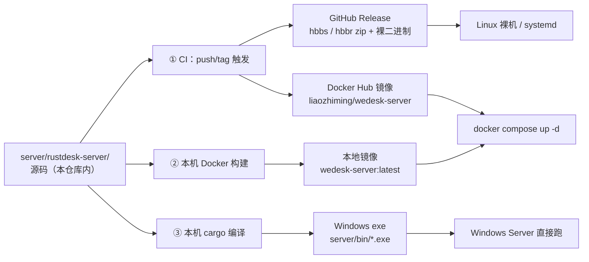

# 09 · 服务端自编译指南（hbbs / hbbr）

**结论先说：服务端不用官方镜像，源码已经在仓库里，你完全可以自己编译。**

> 如果你之前翻遍仓库只找到客户端（exe / MSI）产物，那不是你漏了：
> 上游把服务端拆成了**另一个仓库** `rustdesk/rustdesk-server`，
> 客户端仓库里那条 `src/hbbs_http.rs` 只是"客户端访问服务器 API"的代码，不是服务端本身。
> 本仓库已把服务端源码实体化（vendored）到 `server/rustdesk-server/`，之后两者同版发布。

---

## 一、源码在哪

```
server/
├── Dockerfile              # 容器内从源码编译 → 运行镜像（本机零 Rust 环境时用这个）
├── Dockerfile.prebuilt     # 直接 COPY 已编译二进制（CI 里用这个）
├── .dockerignore           # 关键：把 data/ 私钥挡在镜像之外
├── docker-compose.yml      # 已改为 build 到本地镜像，不再拉官方镜像
├── rustdesk-server/        # ← 服务端源码（独立 Cargo workspace）
│   ├── Cargo.toml / Cargo.lock
│   ├── src/                # hbbs、hbbr、rustdesk-utils 三个 bin
│   ├── libs/hbb_common/    # 上游的 submodule，已实体化
│   ├── db_v2.sqlite3       # 不是运行数据！是 sqlx 编译期校验 SQL 用的模板库
│   └── systemd/            # 裸机部署的 service 文件
```

两个 Dockerfile 的分工：

| 文件 | 输入 | 用在哪 | 首次耗时 |
|---|---|---|---|
| `Dockerfile` | 源码 | 本机构建（有 Docker 就行，不用装 Rust） | 15–25 分钟 |
| `Dockerfile.prebuilt` | 编译好的二进制 | CI：上一个 job 刚编完，直接装包 | 约 10 秒 |

---

## 二、三条获得产物的路径



### 2.1 路径 ① —— CI 自动编译（推荐，最省心）

推送标签即触发，与客户端在同一次发版里产出：

```bash
build\tag-release.bat        # 打标签并推送（版本自动取自根 Cargo.toml）
```

流水线里的 `build-server` job 会编译 musl 静态二进制，`server-image` job 把镜像推到
Docker Hub（`liaozhiming/wedesk-server`）。
推送用的 `DOCKER_USERNAME` / `DOCKER_PASSWORD` 是仓库 secrets，在
Settings → Secrets and variables → Actions 里配置。

那个 job **不是在 runner 上直接 `cargo build --target musl`**，而是起一个 `rust:alpine` 容器、
在里面本机编译（`server/build-musl.sh`）。原因见第 6 节那条 OpenSSL 报错的说明。
跑完后同一个 GitHub Release 里同时有：

| 产物 | 形态 | 用途 |
|---|---|---|
| `wedesk-server-<ver>-linux-x64-musl.zip` | zip | 拷到 Linux 服务器上解压即用 |
| `hbbs` / `hbbr` / `rustdesk-utils` | 裸二进制 | 直接扔进 `/usr/bin` |
| `liaozhiming/wedesk-server:latest` | 容器镜像 | `docker pull` 后用于 compose |

> **为什么服务端编译要和客户端放在同一条流水线**：两条流水线都往同一个 Release 传文件，
> 必然出现竞态——谁先跑完谁创建 Release，后到的要么覆盖要么失败。合并是根治办法。

### 2.2 路径 ② —— 本机 Docker 构建镜像

没有 Rust、没有 musl、没有 MSVC 也能做，编译全在容器里：

```bash
build\build-server-image.bat                 # → wedesk-server:latest (linux/amd64)
build\build-server-image.bat 1.1.17          # 指定标签
```

等价于手动执行：

```bash
cd server
docker build --platform linux/amd64 -t wedesk-server:latest -f Dockerfile .
```

> `--platform linux/amd64` 别省：在 Windows / Apple Silicon 的 Docker Desktop 上，
> 默认平台是本机架构，编出来的镜像丢到 x86 Linux 服务器上会跑不起来。
>
> 这条命令和 CI 里的 `build-server` job 走的是**同一份脚本** `server/build-musl.sh`。
> 所以改编译环境（加系统依赖、加 feature、换 target）只改那一处，
> 不要单独给 CI 写一套 —— 两套配方迟早漂移成"CI 绿但本机 docker build 红"。

### 2.3 路径 ③ —— 本机 cargo 编译 Windows exe

想直接得到 `hbbs.exe` / `hbbr.exe`（例如部署到 Windows Server）：

```bash
build\build-server.bat                      # → server\bin\*.exe
build\build-server.bat --debug              # 排障版，编译更快
```

这条路径有两个硬要求，脚本会先检查再动手：

| 要求 | 原因 | 不满足的表现 |
|---|---|---|
| MSVC（`cl.exe` 在 PATH） | 服务端带 C 依赖（libsodium / sqlite） | link 阶段 `LINK : fatal error LNK1181` |
| Rust ≥ **1.78** | 服务端 `Cargo.lock` 是 lockfile **v4** | `lock file version 4 requires -Znext-lockfile-bump` |

> **客户端锁 1.75、服务端必须 ≥1.78，两边不会打架。**
> 客户端锁版本是为了 sciter/bridge 的 i128 ABI；服务端是独立 workspace，
> 脚本会自动切到 stable toolchain（`RUSTUP_TOOLCHAIN=stable`）。
> 所谓"同一套 Rust 版本更省心"在这里是错的，硬统一反而两边都编不过。

---

## 三、我们改了服务端什么

改动极小，且**可以退回上游行为**：

| 文件 | 改动 | 理由 |
|---|---|---|
| `src/common.rs` | `check_software_update()` 默认直接返回 | 上游会常驻一个线程，每 24 小时向 `https://api.rustdesk.com/version/latest` POST 一次 |

完整 diff 在 [`upstream/server.patch`](../upstream/server.patch)，可 `git apply` 校验。
需要恢复原行为（比如要跟踪上游版本）时，给容器加环境变量即可，**不用重新编译**：

```yaml
environment:
  - WEDESK_CHECK_UPDATE=1
```

除此之外服务端源码保持上游原样 —— 这是刻意的：私有化部署的关键在于"能编译、能用、能升级"，
改动越少，将来跟进上游越安全。

---

## 四、部署方式

### 4.1 容器（推荐）

```bash
cd server
cp .env.example .env          # 编辑 RELAY_HOST = 服务器 IP
python rdctl.py build         # 从源码构建镜像（首次）
python rdctl.py start         # 启动，并打印服务器公钥
python rdctl.py key           # 再打印一次公钥（填进客户端 custom.toml）
```

`docker-compose.yml` 里 hbbs / hbbr 都是 `image: ${RD_IMAGE:-wedesk-server:latest}` + `build:` 组合：
本地有镜像就用本地的，没有就先构建。**`RD_IMAGE` 改回 `rustdesk/rustdesk-server:latest` 可以瞬间回到官方镜像**
（会同时失去上面那条本地化补丁）。

⚠️ 这里有个容易踩的坑：**`docker compose up`（不带 `--build`）不会因为源码变了就重新构建**，
只要本地存在同 tag 的镜像就直接复用。改过 `server/rustdesk-server/` 源码或本 Dockerfile 之后，
必须显式构建一次，否则跑的还是旧镜像：

```bash
docker compose build            # 有层缓存，通常几分钟
docker compose build --no-cache # 彻底重编，首次约 15-25 分钟
docker compose up -d
```

同理，`.env` 里 `RD_IMAGE` 一旦指向远端镜像，本地 Dockerfile 就完全不参与 ——
排查这类问题时先跑 `docker compose config | grep -i image` 确认到底用的是哪个镜像。

### 4.2 Linux 裸机（不用 Docker）

CI 产出的二进制是 **musl 静态链接**，任意发行版直接跑，不挑 glibc 版本：

```bash
sudo install -m 0755 hbbs hbbr rustdesk-utils /usr/bin/
sudo cp systemd/* /etc/systemd/system/     # 解压 zip 后 systemd/ 就在同级目录
sudo mkdir -p /var/lib/rustdesk-server /var/log/rustdesk-server
sudo systemctl enable --now rustdesk-hbbr rustdesk-hbbs
```

上游的 service 单元里 `WorkingDirectory=/var/lib/rustdesk-server/`，
密钥与数据库都会落在这里，迁移主机时整个目录拷走即可。
`User=` / `Group=` 两行是空的（默认 root），需要降权运行时记得同时改目录属主。

> 单元文件若被检出成了 CRLF，systemd 会静默忽略整份文件 —— 服务起不来且不报错。
> 本仓库 `.gitattributes` 已把 `server/**/*.service` 钉成 LF，若仍异常请先确认换行。

### 4.3 密钥必须两端一致

这是"服务端起来了但客户端连不上"的头号原因。服务器公钥（`/root/id_ed25519.pub`
或 `server/data/id_ed25519.pub`）必须等于客户端内置的 `RS_PUB_KEY`：

| 端 | 位置 |
|---|---|
| 服务端 | 首次启动自动生成于工作目录；已有密钥请整体拷贝，不要重新生成 |
| 客户端 | `libs/hbb_common/src/config.rs` 的 `RS_PUB_KEY`，由 `build/custom.toml` 注入 |

---

## 五、升级上游服务端

跟进上游安全修复时的流程：

```bash
# 1. 改新版本的 commit sha 并重跑导出（会整包覆盖 rustdesk-server/）
python build/vendor-server.py --server-rev <新commit>

# 2. 先确认补丁还能重放。这一步必须在 apply 之前 ——
#    已经 apply 过再 --check 会因为"改动已存在"而失败，那是假阴性。
git apply --check upstream/server.patch

# 3. 重放改动
git apply upstream/server.patch

# 4. 本地验证能编译
build\build-server.bat
```

第 2 步失败说明上游改了我们打补丁的那段代码。这时要人工看
`src/common.rs` 的 `check_software_update()` 现状重新做补丁，
并把新 diff 写回 `upstream/server.patch`。

脚本会把锁定的两个 sha 写进 `build/server-vendor.json`（服务端自身 + 它的 hbb_common），
下次升级有据可查。**不要手工去修改 `rustdesk-server/` 里的文件**
——它下次会被整包覆盖，改动会静默消失；要改就走补丁 + 登记。

---

## 六、常见报错速查

| 报错 / 现象 | 原因 | 处理 |
|---|---|---|
| `lock file version 4 requires -Znext-lockfile-bump` | cargo < 1.78 | 用 stable toolchain：`RUSTUP_TOOLCHAIN=stable` |
| `Could not find directory of OpenSSL installation ... set the OPENSSL_DIR` | 在 glibc 机器上交叉编译到 musl，openssl-sys 找不到**目标平台**的 OpenSSL | 改在 musl 容器里本机编译（`server/build-musl.sh`）。<br>详情见下方第 6.1 节 |
| `DATABASE_URL must be set` / `No such file or directory: db_v2.sqlite3` | sqlx 宏编译期要连 SQLite | 脚本里已设 `DATABASE_URL=sqlite:///src/db_v2.sqlite3`；<br>手动编译时需自己设，路径必须是**绝对**的 |
| 容器内 `hbbs: not found` | 二进制是 glibc 版，却拷进了 alpine | 必须用 musl 静态编译；检查 target 是否为 `*-unknown-linux-musl` |
| `perl: not found`（构建阶段） | ring(TLS) 的构建脚本依赖 perl | `build-musl.sh` 里已装 perl；别精简掉 `build-base musl-dev perl` |
| 构建阶段 `git: command not found` | Cargo.lock 钉了 7 个 git 依赖（reqwest/confy/sysinfo 等），cargo 要现场 clone | 容器内装 git（脚本里已装） |
| 启动就报端口占用 | 本机已有进程占着派生端口 | `python rdctl.py stop` 后再起，或整体平移 `HBBS_PORT` / `HBBR_PORT`。<br>**别只改主端口** —— P-1 与 P+2 也要一并挪开，见 [10 端口规划](10-ports.md) |
| 客户端连不上，日志无报错 | 两端公钥不一致 | 核对 `rdctl.py key` 与 `build/custom.toml` 的 key 是否相同 |
| `docker build` 卡在 crates.io 下载 | 容器内网络慢 | 重试一次即可；CI 里有 cargo registry 缓存，本机建议 `--platform` 保持一致以复用层缓存 |
| CI 里 `cp: cannot stat 'target//release/hbbs'`（注意路径里的**双斜杠**） | 打包步骤拼路径用的三元组变量为空 | 见下方第 6.2 节 |
| `docker compose up` 报 `exec: "hbbr": executable file not found in $PATH` | 跑起来的镜像里根本没有可执行的 `hbbr`。<br>两种成因：① Dockerfile 编译阶段把 cargo 的 target 目录挂成了 BuildKit cache mount，产物不进镜像层；② `.env` 的 `RD_IMAGE` 指向了别的镜像，本地 Dockerfile 压根没参与构建 | 见下方第 6.3 节 |

### 6.1 OpenSSL 报错：为什么不在 runner 上交叉编译

原始错误信息长这样：

```
Could not find directory of OpenSSL installation, and this `-sys` crate cannot
proceed without this knowledge. ... you can set the `OPENSSL_DIR` environment
variable for the compilation process.
$HOST = x86_64-unknown-linux-gnu
$TARGET = x86_64-unknown-linux-musl
openssl-sys = 0.9.104
```

**为什么会发生**：`hbbs` 的依赖链里有 `native-tls → openssl → openssl-sys`
（`hbbs → hbb_common → tokio-native-tls → native-tls → openssl-sys`，以及
`hbbs → reqwest → hyper-tls → native-tls → openssl-sys` 两条路）。
openssl-sys 的构建脚本会按 **target triple** 去找 OpenSSL。runner 是 glibc 环境，
就算装了 `libssl-dev`，那也是给 glibc 编的 —— 链接 musl 目标时格式不匹配，
于是它报告"没找到安装"。

#### 修法一（不推荐）：手工给 musl 编一份 OpenSSL

```bash
# 大致如此，细节随发行版与版本浮动
export CC=musl-gcc
./Configure linux-x86_64 no-shared --prefix=/opt/openssl-musl
make && make install
export OPENSSL_DIR=/opt/openssl-musl
export OPENSSL_STATIC=1
```

能过，但这条路的问题在于：编出来的东西绑死宿主机的发行版与 runner 镜像版本，
GitHub 换一次 runner image、本机换一台机器就重新失效；而且 OpenSSL 全量编译本身就要几分钟。

#### 修法二（本仓库采用）：在 musl 容器里本机编译

```bash
docker run --rm \
  -v "$PWD/server/rustdesk-server:/src" \
  -v "$PWD/server/build-musl.sh:/build-musl.sh:ro" \
  -e TARGET=x86_64-unknown-linux-musl \
  rust:1.90-alpine sh /build-musl.sh
```

容器的 host triple 本身就是 `x86_64-unknown-linux-musl`，容器里 `apk add openssl-dev`
拿到的就是给 musl 编好的 OpenSSL，pkg-config 一查即中，零配置。

代价：runner 上必须有 Docker（GitHub 托管的 Linux runner 自带）。
收益：与本机 `docker build` 用的是同一份脚本，两边结果必然一致。

脚本里另外做了两件小事，都是为了跨环境可复现：

- `export OPENSSL_STATIC=1` + 逐个安装 `*-static` 子包 —— 让产物真正静态。
  缺某个 `-static` 包时只降级成动态链接并告警，不至于让整次构建失败；
- 末尾用 `file` 打印每个二进制的链接方式，让"到底静不静态"看得见 ——
  真出现"Docker 里能跑、裸二进制起不来"，先来看这里。

> 注意 **hbbs/hbbr 的端口不写在源码里**，是靠 `docker-compose.yml` 的
> `command: hbbs -p 5187` / `hbbr -p 5188` 传入的。重新编译不会改变端口。
> 端口推导规则见 [10 端口规划](10-ports.md)。

### 6.2 `cp: cannot stat 'target//release/hbbs'`：路径里的双斜杠就是线索

完整报错：

```
Run set -e
cp: cannot stat 'target//release/hbbs': No such file or directory
Error: Process completed with exit code 1
```

**注意 `target//release` 中间那个双斜杠** —— 它不是笔误，而是拼路径的变量为空，
`target/${TRIPLE}/release` 变成了 `target//release`。

根因是"目标三元组"有两个真源：`server/build-musl.sh` 里 `TARGET` 有默认值
`x86_64-unknown-linux-musl`，而打包步骤直接读 workflow 的 `env.SERVER_TARGET`。
一旦 env 里漏配，编译按脚本默认值把产物放进 `target/x86_64-unknown-linux-musl/release/`，
打包却去 `target//release` 找 —— 编译是成功的，只是两边对不上。

现在的处理是**把真源收敛成一处**：构建步骤算出三元组后写进 step output，
打包步骤只认这个值；另外加了兜底与诊断（找不到时会打印 `target/` 的真实目录结构），
不会再只留一句 `cannot stat` 让人从头猜。

自己改构建流程时注意：三元组在三处各有一份默认值，必须保持一致 ——

| 位置 | 用途 |
|---|---|
| `.github/workflows/build-windows.yml` 的 `env.SERVER_TARGET` | CI 打包与缓存路径 |
| `server/build-musl.sh` 的 `TARGET="${TARGET:-...}"` | 未收到环境变量时的兜底 |
| `server/Dockerfile` 的 `ARG TARGET=...` | 最终 `COPY --from=builder` 的源路径 |

### 6.3 `exec: "hbbr": executable file not found in $PATH`

完整报错：

```
[+] Running 2/2
✔ Container rd-hbbr  Recreated
✔ Container rd-hbbs  Recreated
Attaching to rd-hbbr, rd-hbbs
Error response from daemon: failed to create task for container: failed to create
shim task: OCI runtime create failed: runc create failed: unable to start container
process: error during container init: exec: "hbbr": executable file not found in $PATH: unknown
```

**先看懂这句话**：它说的是容器 init 进程（也就是 `command:` 的第一段 `hbbr`）
在 `PATH` 里找不到。它**不会**告诉你"镜像里少了个文件"，位置回指的是容器
启动环节，行列上对不上任何一行 Dockerfile —— 所以这条报错几乎没法按图索骥。

先确认一件事（一条命令即可）：

```bash
docker run --rm --entrypoint sh <镜像名> -c "command -v hbbs; command -v hbbr"
```

两条都空 → 镜像里确实没有这两个二进制，往下看成因 A / B；都有路径 → 是别的问题
（多半是动态链接器缺失，见第 6.1 节的"静态性自检"）。

更省事的办法是直接跑 `python server/rdctl.py start` —— 它会在启动前自动检查
镜像里有没有可执行的 hbbs / hbbr，并区分下面三种成因给出对应的处理命令。

**成因 A：Dockerfile 把 cargo 的产物目录挂成了 BuildKit cache mount**

```dockerfile
RUN --mount=type=cache,target=/usr/local/cargo/registry \
    --mount=type=cache,target=/src/target \        # ← 产物目录被挂成 cache
    sh /build-musl.sh
...
COPY --from=builder /src/target/${TARGET}/release/hbbr /usr/bin/hbbr   # ← 落空
```

`type=cache` 的语义就是**跨构建复用、但不进镜像层**：RUN 一结束挂载即卸载，
写进去的东西只留在构建缓存里，绝不会落进镜像层。而 cargo 用 `--target` 时产物
正好写在 `/src/target/$TARGET/release/`，正是挂载点——所以 COPY 拿不到文件。

正确做法是**产物必须落在普通目录，且复制要和编译处在同一个 RUN 内**：
`build-musl.sh` 编译结束后把三个二进制复制到 `/out`，阶段 2 从 `/out` COPY。
cache mount 只留给真正的缓存目录（这里是 `/usr/local/cargo/registry`）。

**成因 B：`.env` 的 `RD_IMAGE` 指到了别的镜像**

`docker-compose.yml` 里是 `image: ${RD_IMAGE:-wedesk-server:latest}` + `build:`
的组合。一旦 `RD_IMAGE` 有值，compose 就直接用（或拉取）那个镜像，
**本地 Dockerfile 不会被执行** —— 你以为在跑自己编的二进制，其实不是。

本仓库的 `.env` 曾残留迁移前的 `RD_IMAGE=rustdesk/rustdesk-server:latest`
（官方镜像），并且端口变量还是已废弃的 `HBBS_TCP` / `HBBS_UDP` / `HBBR_TCP` /
`RELAY_PORT`。这些旧键名 compose **既不报错也不生效**，属于最容易白调半天的
那类问题 —— 现在只认 `HBBS_PORT` / `HBBS_NAT_PORT` / `HBBR_PORT`。

确认当前实际用的是哪个镜像：

```bash
docker compose config | grep -i image
```

**成因 C：artifact 上传/下载把可执行位弄丢了**（本仓库实际踩到的那个）

CI 的镜像链路是：

```
build-server job                 server-image job
  cargo build  → out-server/  ──▶  upload-artifact@v4
  cp hbbs hbbr rustdesk-utils      → zip 打包 → download-artifact@v4
                                   → docker build -f Dockerfile.prebuilt
```

产物在 `build-server` 里明明是 `0755`，但 `actions/upload-artifact@v4` 与
`download-artifact@v4` 走 **zip 打包，不保留 POSIX 可执行位**，下载回来就退化成
`0644`。而 `COPY` 会把这个 mode **原样带进镜像** —— 于是 `/usr/bin/hbbr` 文件在、
大小也正常，但**不是可执行文件**。

这一步极其隐蔽，因为报错措辞是反的：Docker 解析容器 `command` 第一段走的是
**PATH 查找**，而 PATH 查找**要求可执行位**。所以缺执行位时报的不是
`permission denied`，而是一句

```
exec: "hbbr": executable file not found in $PATH
```

把"文件在、只是没 +x"说成了"找不到文件"，把人直接引向"Dockerfile 没 COPY 成功"
的错误方向。而且**构建期全程无报错**，只在 `up` 时才炸。

修法就一行，在 `COPY` 之后无条件补回来（不管上游传过来是什么 mode）：

```dockerfile
COPY hbbs           /usr/bin/hbbs
COPY hbbr           /usr/bin/hbbr
COPY rustdesk-utils /usr/bin/rustdesk-utils

RUN chmod 0755 /usr/bin/hbbs /usr/bin/hbbr /usr/bin/rustdesk-utils
```

**怎么处理**

```bash
# 走本地自编译（"完全本地化"路径）：确保 .env 里 RD_IMAGE 已注释掉
docker compose build --no-cache
docker compose up -d

# 或走 CI 推送的镜像：让 CI 重新推送后
docker compose pull
docker compose up -d
```

构建阶段现在会**实际执行**一次 `hbbs` / `hbbr` / `rustdesk-utils`，
镜像里少了或跑不起来会直接构建失败，不会再拖到 `docker compose up` 才炸。

---

## 七、版本对应关系

| 组件 | 版本来源 | 说明 |
|---|---|---|
| 客户端 | 仓库根 `Cargo.toml`（当前 1.5.1） | `build\tag-release.bat` 取的就是它 |
| 服务端 | `server/rustdesk-server/Cargo.toml`（当前 1.1.17） | 与客户端版本各自演进，互不绑定 |
| 容器镜像标签 | 沿用 Release 标签 | `liaozhiming/wedesk-server:<tag>` |

两者没有版本号必须对齐的要求 —— 只要**交互协议兼容**即可。
升级时建议先升客户端看是否正常，再升服务端，出问题好二分定位。
